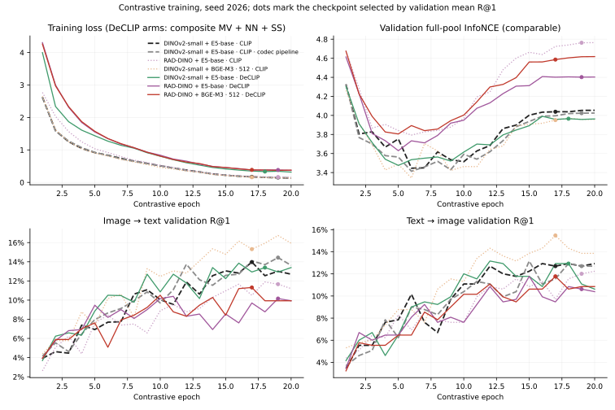
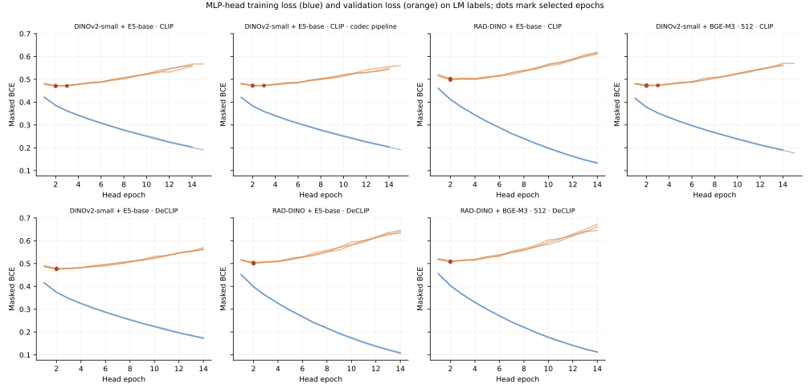
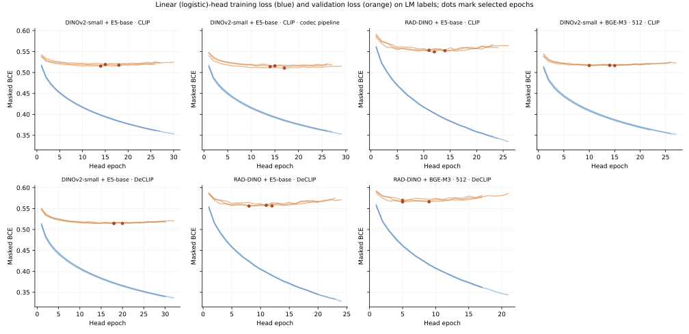

# Codec-pipeline replicate and DeCLIP arms: training record and results

Status: **complete**. All new arms ran from the codec-fix worktree (`fix/kaggle-dicom-codecs` @ `35dfa0e`: per-syntax decoder pins, decode counters, inference series fallback) on the gold-holdout cohort, contrastive seed 2026, and were read out with the 58-case LM-label head protocol of [lm-head-tower-size-58-v1.md](lm-head-tower-size-58-v1.md). Matrix: `configs/contrastive/codec-declip-v1.json`. Plain-CLIP comparators come from [next-model-pairs-v1.md](next-model-pairs-v1.md).

**What the codec pipeline can and cannot change here.** All 13,221 selected training series are uncompressed Explicit VR Little Endian (one file per series scanned, 2026-09-27), the codec fix keeps every decodable file on its previous decoder, `PREPROCESSING_VERSION` is unchanged, and the image cache is reused. The codec-pipeline run therefore sees bit-identical inputs to the reference: its differences measure run-to-run CUDA nondeterminism, which makes it a second baseline run.

## Answer

- **Codec-pipeline replicate (2026-09-27): no performance difference, as expected.** Its inputs are bit-identical to the
  reference's, and every gap is inside run-to-run noise:
  - gold MLP 0.7670 vs 0.7659 (Δ +0.0011 [−0.0143, +0.0164]);
  - LM-test MLP 0.8303 vs 0.8336 (Δ −0.0033 [−0.0095, +0.0030]);
  - selected mean R@1 13.57% vs 13.34%, I→T 14.43% vs 13.97%, T→I 12.70% vs 12.70%.

  Per-epoch mean R@1 differs by a median of 0.0035. Epoch-1 training loss agrees to 2.3e-4, and the two runs diverge
  afterwards through CUDA nondeterminism. The codec fix is therefore safe to train with, but it is not an accuracy lever.
  All later arms run on it anyway.
- **This pair is the second baseline run.** The reference and the replicate bracket single-seed noise. On LM-test MLP
  AUROC they span 0.830–0.834, and on gold MLP 0.766–0.767.
- **DeCLIP on DINOv2-small + E5-base (2026-09-27): no gain, a null result.**
  - Gold MLP 0.7686 is just above the 0.7659–0.7670 baseline pair (Δ vs reference +0.0027 [−0.0134, +0.0194]).
  - LM-test MLP 0.8315 is inside the 0.8303–0.8336 pair (Δ −0.0021 [−0.0101, +0.0056]).
  - Selected mean R@1 13.16% is below both baselines (13.34%, 13.57%), well inside the ~0.024 single-seed spread.
  - The linear control moves in opposite directions on the two measures: gold +0.0150, LM-test −0.0091, both
    intervals spanning zero. That is consistent with noise.
  - DeCLIP cost 1.32 h against 0.86 h for plain CLIP, with 4.7 GB peak (gradient checkpointing).
  - This repeats the earlier declip-v1 finding (DeCLIP + LoRA ≈ LoRA) on the gold-holdout protocol.
- **DeCLIP on RAD-DINO + E5-base (2026-09-27): DeCLIP does not rescue RAD-DINO.** Against plain RAD-DINO with the
  same towers, the differences are nil:
  - gold MLP 0.7189 vs 0.7246 (Δ −0.0057 [−0.0216, +0.0103]);
  - LM-test MLP 0.8031 vs 0.8027 (Δ +0.0004 [−0.0064, +0.0065]).

  Against the DINOv2 baselines it is clearly worse:
  - gold MLP Δ −0.047 [−0.082, −0.012] vs the reference and −0.048 vs the replicate;
  - LM-test MLP Δ −0.031 [−0.046, −0.016] and −0.027. Both intervals exclude zero.

  Retrieval fell slightly below plain RAD-DINO (mean R@1 10.39% vs 11.84%), although the lowest validation loss
  improved (3.63 vs 3.79). It trained faster than plain RAD-DINO (2.1 h vs 3.7 h), because gradient checkpointing kept
  the peak at 6.0 GB instead of spilling past 8 GB. The RAD-DINO deficit is a property of the image tower at this
  224-pixel input, not of the objective.
- **DeCLIP on RAD-DINO + BGE-M3 · 512 (2026-09-28): a larger text tower does not close the RAD-DINO gap.** Gold MLP
  0.7339 and LM-test MLP 0.8027. Against the DINOv2 baselines:
  - gold Δ −0.032 [−0.067, +0.002] vs the reference and −0.033 [−0.066, −0.001] vs the replicate;
  - LM-test Δ −0.031 [−0.045, −0.016] and −0.028 [−0.042, −0.013].

  Against DeCLIP RAD-DINO + E5-base, BGE-M3 adds +0.015 [−0.003, +0.033] gold and nothing on LM-test (0.8027 vs 0.8031).
  That matches the BGE-M3 hint on DINOv2 (+0.009 gold, not significant) in direction only. It had the best retrieval
  of the RAD-DINO arms (mean R@1 11.55%) but the worst lowest validation loss (3.81). Training took **10.2 h** at a
  9.5 GB peak (spilling past the 8 GB GPU), against 2.1 h for the E5-base arm.
- **Bottom line.** The deployed DINOv2-small + E5-base with plain CLIP stays the reference:
  - the codec pipeline is neutral for training;
  - DeCLIP is neutral on DINOv2;
  - RAD-DINO is worse on LM-test by about 0.03 however it is trained, and BGE-M3 doesn't change that.

  The one untested RAD-DINO variable is its native 518-pixel preprocessing.

## Results

Gold AUROCs are macro over 12 labels on all 58 gold studies, which no head training, validation, or epoch selection used. **LM-test AUROC** is masked macro AUROC against `lm_labels_kaggle.csv` verdicts on the 432 non-gold locked-test studies (UNK ignored). Each head is the probability average of seeds 2026–2028. Δ columns are arm minus base with a 95% paired study-bootstrap interval (gold: 5,000 resamples; LM-test: 2,000).

| Image tower | Text tower | Objective | Gold linear | Gold MLP | Δ gold MLP vs reference | Δ gold MLP vs replicate | LM-test linear | LM-test MLP | Δ LM-test MLP vs reference | Δ LM-test MLP vs replicate |
|---|---|---|---:|---:|---|---|---:|---:|---|---|
| DINOv2-small | E5-base | CLIP (reference) | 0.7336 | 0.7659 | — | -0.0011 [-0.0164, +0.0143] | 0.8140 | 0.8336 | — | +0.0033 [-0.0030, +0.0095] |
| DINOv2-small | E5-base | CLIP · codec pipeline | 0.7361 | 0.7670 | +0.0011 [-0.0143, +0.0164] | — | 0.8142 | 0.8303 | -0.0033 [-0.0095, +0.0030] | — |
| RAD-DINO | E5-base | CLIP | 0.7272 | 0.7246 | -0.0414 [-0.0750, -0.0085] | -0.0424 [-0.0748, -0.0106] | 0.7882 | 0.8027 | -0.0309 [-0.0451, -0.0164] | -0.0277 [-0.0413, -0.0123] |
| DINOv2-small | BGE-M3 · 512 | CLIP | 0.7573 | 0.7746 | +0.0087 [-0.0105, +0.0290] | +0.0076 [-0.0122, +0.0286] | 0.8252 | 0.8415 | +0.0079 [-0.0002, +0.0155] | +0.0111 [+0.0023, +0.0196] |
| DINOv2-small | E5-base | DeCLIP | 0.7486 | 0.7686 | +0.0027 [-0.0134, +0.0194] | +0.0016 [-0.0157, +0.0194] | 0.8050 | 0.8315 | -0.0021 [-0.0101, +0.0056] | +0.0011 [-0.0068, +0.0097] |
| RAD-DINO | E5-base | DeCLIP | 0.7191 | 0.7189 | -0.0470 [-0.0824, -0.0122] | -0.0481 [-0.0823, -0.0152] | 0.7849 | 0.8031 | -0.0305 [-0.0455, -0.0156] | -0.0273 [-0.0415, -0.0122] |
| RAD-DINO | BGE-M3 · 512 | DeCLIP | 0.7298 | 0.7339 | -0.0321 [-0.0665, +0.0020] | -0.0331 [-0.0660, -0.0005] | 0.7909 | 0.8027 | -0.0309 [-0.0452, -0.0158] | -0.0276 [-0.0418, -0.0126] |

**DeCLIP vs plain CLIP with the same towers** (MLP heads):

| DeCLIP arm | CLIP counterpart | Δ gold MLP | Δ LM-test MLP |
|---|---|---|---|
| DINOv2-small + E5-base · DeCLIP | DINOv2-small + E5-base · CLIP | +0.0027 [-0.0134, +0.0194] | -0.0021 [-0.0101, +0.0056] |
| RAD-DINO + E5-base · DeCLIP | RAD-DINO + E5-base · CLIP | -0.0057 [-0.0216, +0.0103] | +0.0004 [-0.0064, +0.0065] |

### Run-to-run noise (reference vs codec-pipeline replicate)

- Selected mean R@1 gap: **+0.0023** (earlier identical-config pair: 0.024).
- Per-epoch |Δ mean R@1| over 20 epochs: median **0.0035**, max 0.0127 (earlier pair: median ~0.0087).
- Per-epoch |Δ validation loss|: median 0.0539; epoch-1 |Δ train loss| 2.34e-04.

A treatment arm is only interesting if it lands outside the reference–replicate pair on both gold and LM-test.

### Contrastive training

Selected epoch follows the frozen rule: validation mean R@1 descending, then validation loss, then earliest epoch. Validation loss is plain symmetric InfoNCE over the full 433-pair pool for every arm, so it is comparable across CLIP and DeCLIP. Training loss is in-batch; for DeCLIP it is the composite objective (multi-view InfoNCE + 0.5 × nearest-neighbour + 0.5 × image SimCLR), so it is **not** comparable with the CLIP arms.

| Image tower | Text tower | Objective | Selected epoch | Train loss | Val loss selected / min / final | I→T R@1 | T→I R@1 | Mean R@1 | Hours | Peak GPU alloc |
|---|---|---|---:|---:|---|---:|---:|---:|---:|---:|
| DINOv2-small | E5-base | CLIP | 17 | 0.171 | 4.039 / 3.446 / 4.054 | 13.97% | 12.70% | 13.34% | — | — |
| DINOv2-small | E5-base | CLIP · codec pipeline | 19 | 0.144 | 4.024 / 3.414 / 4.025 | 14.43% | 12.70% | 13.57% | 0.9 | 7.5 GB |
| RAD-DINO | E5-base | CLIP | 19 | 0.165 | 4.763 / 3.794 / 4.764 | 11.66% | 12.01% | 11.84% | 3.7 | 10.2 GB |
| DINOv2-small | BGE-M3 · 512 | CLIP | 17 | 0.159 | 3.951 / 3.343 / 3.957 | 15.32% | 15.47% | 15.40% | 2.4 | 9.9 GB |
| DINOv2-small | E5-base | DeCLIP | 18 | 0.334 | 3.965 / 3.475 / 3.963 | 13.39% | 12.93% | 13.16% | 1.3 | 4.7 GB |
| RAD-DINO | E5-base | DeCLIP | 19 | 0.382 | 4.402 / 3.630 / 4.403 | 10.16% | 10.62% | 10.39% | 2.1 | 6.0 GB |
| RAD-DINO | BGE-M3 · 512 | DeCLIP | 17 | 0.385 | 4.586 / 3.805 / 4.618 | 11.32% | 11.78% | 11.55% | 10.2 | 9.5 GB |



### LM-label heads

| Image tower | Text tower | Objective | MLP selected epochs | MLP mean val BCE | Linear selected epochs | Linear mean val BCE |
|---|---|---|---|---:|---|---:|
| DINOv2-small | E5-base | CLIP | 3, 2, 2 | 0.4708 | 15, 18, 14 | 0.5173 |
| DINOv2-small | E5-base | CLIP · codec pipeline | 3, 2, 2 | 0.4722 | 15, 14, 17 | 0.5135 |
| RAD-DINO | E5-base | CLIP | 2, 2, 2 | 0.5004 | 14, 12, 11 | 0.5516 |
| DINOv2-small | BGE-M3 · 512 | CLIP | 3, 2, 2 | 0.4726 | 15, 14, 10 | 0.5168 |
| DINOv2-small | E5-base | DeCLIP | 2, 2, 2 | 0.4768 | 20, 18, 18 | 0.5146 |
| RAD-DINO | E5-base | DeCLIP | 2, 2, 2 | 0.5019 | 8, 12, 11 | 0.5568 |
| RAD-DINO | BGE-M3 · 512 | DeCLIP | 2, 2, 2 | 0.5087 | 9, 5, 5 | 0.5673 |





### Gold AUROC by label (MLP)

| Label | DINOv2-small + E5-base · CLIP | DINOv2-small + E5-base · CLIP · codec pipeline | RAD-DINO + E5-base · CLIP | DINOv2-small + BGE-M3 · 512 · CLIP | DINOv2-small + E5-base · DeCLIP | RAD-DINO + E5-base · DeCLIP | RAD-DINO + BGE-M3 · 512 · DeCLIP |
|---|---:|---:|---:|---:|---:|---:|---:|
| ACL | 0.6973 | 0.6740 | 0.7733 | 0.6777 | 0.6887 | 0.7708 | **0.7806** |
| Baker's | 0.8388 | 0.8333 | 0.6576 | **0.8714** | 0.8605 | 0.6413 | 0.6830 |
| Contusion | 0.7773 | 0.7760 | 0.6356 | **0.8111** | 0.7557 | 0.6127 | 0.6491 |
| Effusion | **0.9081** | 0.8807 | 0.9043 | 0.8932 | 0.8683 | 0.8882 | 0.9043 |
| Fracture | 0.6597 | 0.6569 | 0.5972 | **0.6625** | 0.6486 | 0.6153 | 0.5958 |
| Lateral Meniscus | 0.7130 | 0.7255 | 0.7019 | 0.6609 | **0.7267** | 0.6807 | 0.6994 |
| Lateral OA | 0.7060 | 0.7389 | 0.7195 | **0.7640** | 0.7215 | 0.7350 | 0.7408 |
| MCL | 0.6122 | 0.6281 | 0.6327 | 0.6327 | **0.6599** | 0.6327 | 0.6508 |
| Medial Meniscus | 0.7608 | 0.7596 | 0.7728 | 0.7344 | 0.7740 | 0.7656 | **0.7764** |
| Medial OA | 0.9349 | 0.9349 | 0.8279 | 0.9488 | **0.9519** | 0.8109 | 0.8295 |
| PF OA | 0.7825 | 0.8005 | 0.8018 | **0.8172** | 0.7838 | 0.7876 | 0.7954 |
| Synovitis | 0.8005 | 0.7957 | 0.6703 | **0.8220** | 0.7838 | 0.6858 | 0.7013 |

## Training settings

Shared by every arm (the reference settings): 2.5D input, 3 planes × 3 slices at 224², ImageNet normalization; LoRA on the last 6 blocks of both towers, rank 64, alpha 128, dropout 0; batch 32; 20 epochs; learning rate 1e-4 image/text and 1e-3 projection; weight decay 0.02; 10% linear warmup then cosine; 256-d projection; original full reports.

| Arm | Swaps vs reference |
|---|---|
| Codec-pipeline replicate | None (codec worktree source) |
| DeCLIP + DINOv2-small + E5-base | `--use-declip`: multi-view InfoNCE weight 1.0 (image augmentation + 15% report token masking, four cross-modal pairs), nearest-neighbour report supervision weight 0.5 with a 512-report FIFO queue, image SimCLR weight 0.5; gradient checkpointing (memory only) |
| DeCLIP + RAD-DINO + E5-base | The DeCLIP settings above; image tower `microsoft/rad-dino` @ `110cbc18`, at the reference 224-pixel ImageNet-normalized input, as in the next-model-pairs RAD-DINO arm |
| DeCLIP + RAD-DINO + BGE-M3 · 512 | As the row above; text tower `BAAI/bge-m3` @ `5617a9f6`, 512 tokens, mean pooling, no `query: ` prefix |

## Limits

- **One contrastive seed per arm.** The replicate row is the only measure of tower-training variation; the paired intervals condition on the fitted towers and heads.
- **The 58 gold labels are not a clean test.** They have been examined repeatedly; treat gold differences as exploratory.
- **LM-test AUROC scores against LM pseudo-labels**, like-for-like across arms but not a gold measure.
- The codec pipeline is only exercised on compressed data at Kaggle inference; see `.scratch/input-preproc-hypotheses/r9-kaggle-bundle-check.md`.

## Reproduction

```bash
# from the codec worktree (data/processed, lm_labels_kaggle.csv and checkpoints symlinked to the main checkout)
.venv/bin/python scripts/training/run_contrastive_matrix.py --matrix configs/contrastive/codec-declip-v1.json --dry-run
# each arm under scripts/training/run_measured_training.py, then per arm:
.venv-cuda/bin/python scripts/training/train_lm_head.py --config configs/kaggle/lm-mlp-codec-declip-58-<arm>.json \
  --features checkpoints/kaggle/lm-mlp-codec-declip-58-<arm>-features.npz \
  --output checkpoints/kaggle/lm-mlp-codec-declip-58-<arm> --device cuda
# unadapted anchors: the same command with <arm> = unadapted-dinov2-small, unadapted-rad-dino (image_baseline configs)
# this page, its JSON and figures
.venv/bin/python scripts/digests/build_codec_declip_digest.py
```
