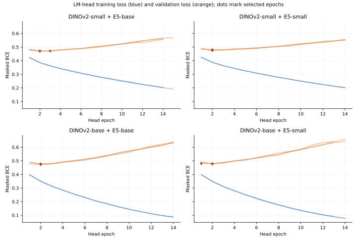
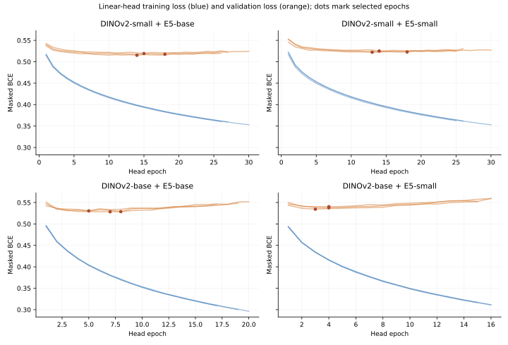

# LM-supervised head comparison across four tower pairings (58 gold cases)

## Question and protocol

Does pairing towers of similar size improve downstream pathology AUROC, and does the larger text tower cause the smaller image tower to overfit? This run evaluates the four previously selected, gold-holdout contrastive checkpoints with the same downstream task: a 12-label head trained on `data/lm_label/lm_labels_kaggle.csv` and evaluated on all 58 binary gold-labeled studies in `data/cleaned.csv`.

The image encoder is frozen for feature extraction. The input to each head concatenates the CLS token and mean patch token, then averages those vectors uniformly across image planes. Each arm fits the same linear control and one-hidden-layer 256-unit MLP, with seeds 2026, 2027, and 2028. LM `YES` and `NO` verdicts provide targets; `UNK` is masked. The head uses 3,438 training studies and 426 validation studies. Minimum validation masked BCE selects each epoch before any gold label is scored. The three selected heads within each architecture are averaged by predicted probability. Head optimization settings, LM source, cohort manifest, seed list, feature definition, and gold scoring are identical across the four checkpoints.

The manifest has 56 gold studies in the excluded split and two in the test split. The requested evaluation includes both groups, totaling 58 gold studies. All 58 are excluded from head training and validation, including the 57 that also have LM pseudo-label rows. The two formerly reserved test studies are now examined and cannot serve as an untouched future test. The four contrastive checkpoints were previously selected using contrastive validation retrieval; this comparison does not retrain those towers.

| Image tower | Text tower | Contrastive checkpoint | Head config |
|---|---|---|---|
| DINOv2-small | multilingual E5-base | `checkpoints/contrastive/both-lora-holdout-v1/holdout-both-lora-depth6-r64-seed2026/best.pt` | `configs/kaggle/lm-mlp-tower-size-58-dinov2-small-e5-base.json` |
| DINOv2-small | multilingual E5-small | `checkpoints/contrastive/tower-size-factorial-v1/dinov2-small-e5-small-depth6-r64-seed2026/best.pt` | `configs/kaggle/lm-mlp-tower-size-58-dinov2-small-e5-small.json` |
| DINOv2-base | multilingual E5-base | `checkpoints/contrastive/tower-size-factorial-v1/dinov2-base-e5-base-depth6-r64-seed2026/best.pt` | `configs/kaggle/lm-mlp-tower-size-58-dinov2-base-e5-base.json` |
| DINOv2-base | multilingual E5-small | `checkpoints/contrastive/size-matched-holdout-v1/dinov2-base-e5-small-depth6-r64-seed2026/best.pt` | `configs/kaggle/lm-mlp-tower-size-58-dinov2-base-e5-small.json` |

## Results

Gold AUROCs use the same 58 gold studies. The MLP column is the primary gold result; linear is the matched supervision control. **LM-test AUROC** is the standard local proxy: masked macro AUROC against LM verdicts on the 432 non-gold locked-test studies, which no head or checkpoint selection used. Contrastive R@1 comes from the previously selected tower checkpoints and is included for context.

| Image tower | Text tower | Contrastive val mean R@1 | LM-linear gold AUROC | LM-MLP gold AUROC | LM-test AUROC | Public score | MLP selected epochs | Mean selected val BCE |
|---|---|---:|---:|---:|---:|---:|---|---:|
| DINOv2-small | E5-base | 0.1334 | 0.7336 | **0.7659** | 0.8336 | 0.788 | 3, 2, 2 | 0.4708 |
| DINOv2-small | E5-small | 0.1547 | 0.7312 | **0.7541** | 0.8275 | 0.774 | 2, 2, 2 | 0.4780 |
| DINOv2-base | E5-base | 0.1426 | 0.7330 | **0.7504** | 0.8324 | — | 2, 2, 2 | 0.4755 |
| DINOv2-base | E5-small | 0.1467 | 0.7362 | **0.7605** | 0.8401 | — | 1, 2, 2 | 0.4788 |

### Full settings and outcome matrix

The contrastive settings below are shared except for the named backbone sizes. The contrastive **256d projection** was trained from image–report pairs in every row. Gold labels or LM verdicts trained the **separate pathology head**; they did not train that projection or change the contrastive similarity targets. Row 1 is the earlier gold-only submission and has a **56-case out-of-fold** local score. Rows 2–5 are **58-case held-out** LM-head scores, so the local AUROCs across those two populations are not a paired before/after comparison. Retrieval recalls are from the selected contrastive checkpoints, not from the pathology head.

| Index | Local AUROC | LM-test AUROC | I→T R@1 | T→I R@1 | Public score | MRI input | Image model | Text model | Image layers adapted | Text layers adapted | Medical report language / view | Batch size | Similarity targets | Tower LR | LoRA rank | LoRA alpha | LoRA dropout | Projection LR | Weight decay | Warmup / schedule | Contrastive projection | Pathology head supervision |
|---|---|---|---|---|---|---|---|---|---|---|---|---|---|---|---|---|---|---|---|---|---|---|
| 1 | 0.7594 (56 OOF) | 0.6844 | 13.97% | 12.70% | 0.717 | 2.5D: 3 planes × 3 slices | DINOv2-small (22.1M) | E5-base (278M) | last 6 blocks (LoRA) | last 6 blocks (LoRA) | Original language, full report; 512 tokens | 32 | CLIP identity targets | 1e-4 image / text | 64 | 128 | 0 | 1e-3 | 0.02 | 10% linear / cosine | 256d | 56 gold labels; logistic OOF |
| 2 | 0.7659 (58 held-out) | 0.8336 | 13.97% | 12.70% | 0.788 | 2.5D: 3 planes × 3 slices | DINOv2-small (22.1M) | E5-base (278M) | last 6 blocks (LoRA) | last 6 blocks (LoRA) | Original language, full report; 512 tokens | 32 | CLIP identity targets | 1e-4 image / text | 64 | 128 | 0 | 1e-3 | 0.02 | 10% linear / cosine | 256d | LM verdicts; 3,438 train / 426 val; 3-seed MLP |
| 3 | 0.7541 (58 held-out) | 0.8275 | 14.55% | 16.40% | 0.774 | 2.5D: 3 planes × 3 slices | DINOv2-small (22.1M) | E5-small (117.7M) | last 6 blocks (LoRA) | last 6 blocks (LoRA) | Original language, full report; 512 tokens | 32 | CLIP identity targets | 1e-4 image / text | 64 | 128 | 0 | 1e-3 | 0.02 | 10% linear / cosine | 256d | LM verdicts; 3,438 train / 426 val; 3-seed MLP |
| 4 | 0.7504 (58 held-out) | 0.8324 | 13.51% | 15.01% | — | 2.5D: 3 planes × 3 slices | DINOv2-base (86.6M) | E5-base (278M) | last 6 blocks (LoRA) | last 6 blocks (LoRA) | Original language, full report; 512 tokens | 32 | CLIP identity targets | 1e-4 image / text | 64 | 128 | 0 | 1e-3 | 0.02 | 10% linear / cosine | 256d | LM verdicts; 3,438 train / 426 val; 3-seed MLP |
| 5 | 0.7605 (58 held-out) | 0.8401 | 13.86% | 15.47% | — | 2.5D: 3 planes × 3 slices | DINOv2-base (86.6M) | E5-small (117.7M) | last 6 blocks (LoRA) | last 6 blocks (LoRA) | Original language, full report; 512 tokens | 32 | CLIP identity targets | 1e-4 image / text | 64 | 128 | 0 | 1e-3 | 0.02 | 10% linear / cosine | 256d | LM verdicts; 3,438 train / 426 val; 3-seed MLP |

LM-test AUROC uses the same 432 locked-test studies in every row, including row 1, so that column is a like-for-like comparison. Public scores come from each run's `leaderboard-submission.json`; see `digest/kaggle-submission-pipeline.md`. The 2.5D input stacks three sampled slices as channels for each of the sagittal, coronal, and axial planes. The size values count pretrained backbone parameters approximately; LoRA and projection parameters are additional.

The MLPs select early epochs. Later training loss falls while LM-label validation loss rises, showing overfitting of the supervised head after its selected epoch. Epoch selection uses validation only.

### Linear control: less late overfitting, lower gold AUROC

The linear heads reach their validation minima later and have a much smaller increase in validation BCE after that point. Their selected models nevertheless score below the selected MLP ensemble on all four gold comparisons. The paired intervals below compare the saved, early-stopped heads on the same 58 studies; they do not compare the deliberately overtrained final epochs.

| Image / text | Linear gold AUROC | MLP minus linear AUROC | Paired 95% interval | Linear selected epochs | Mean validation BCE rise after selection: linear / MLP |
|---|---:|---:|---:|---|---:|
| DINOv2-small / E5-base | 0.7336 | +0.0323 | [+0.0075, +0.0590] | 15, 18, 14 | +0.0051 / +0.0907 |
| DINOv2-small / E5-small | 0.7312 | +0.0229 | [-0.0035, +0.0503] | 14, 18, 13 | +0.0040 / +0.0749 |
| DINOv2-base / E5-base | 0.7330 | +0.0174 | [-0.0048, +0.0401] | 7, 8, 5 | +0.0197 / +0.1596 |
| DINOv2-base / E5-small | 0.7362 | +0.0243 | [+0.0018, +0.0477] | 4, 3, 4 | +0.0194 / +0.1687 |

Linear gold AUROC ranges from 0.7312 to 0.7362 across towers, whereas the selected MLP ensembles range from 0.7504 to 0.7659. Thus the simpler head dampens the late validation-loss rebound, but does not improve gold discrimination in this experiment.

### Paired differences on the 58 gold studies

Positive values favor the first model named in the contrast. Intervals are 95% paired study-bootstrap percentile intervals with 5,000 resamples; they condition on the fitted checkpoints and heads.

| Contrast | Δ macro AUROC | 95% interval |
|---|---:|---:|
| E5-base − E5-small, DINOv2-small | +0.0119 | [-0.0079, +0.0324] |
| E5-base − E5-small, DINOv2-base | -0.0100 | [-0.0312, +0.0114] |
| DINOv2-base − DINOv2-small, E5-base | -0.0155 | [-0.0430, +0.0122] |
| DINOv2-base − DINOv2-small, E5-small | +0.0064 | [-0.0209, +0.0326] |

### Paired differences on the 432 locked-test studies (LM-test AUROC)

Same contrasts, scored against LM verdicts on the locked test split. Intervals are 95% paired study-bootstrap percentile intervals with 2,000 resamples. This proxy favors heads trained on LM verdicts over heads trained on other labels; all four arms here share one LM-head recipe, so the contrasts below are like-for-like.

| Contrast | Δ LM-test AUROC | 95% interval |
|---|---:|---:|
| E5-base − E5-small, DINOv2-small | +0.0061 | [-0.0017, +0.0141] |
| E5-base − E5-small, DINOv2-base | -0.0077 | [-0.0160, +0.0007] |
| DINOv2-base − DINOv2-small, E5-base | -0.0012 | [-0.0108, +0.0084] |
| DINOv2-base − DINOv2-small, E5-small | +0.0126 | [+0.0028, +0.0223] |

### AUROC by gold label

| Label | Gold positives / 58 | Small image + base text | Small image + small text | Base image + base text | Base image + small text |
|---|---:|---:|---:|---:|---:|
| ACL | 24 | 0.6973 | 0.6850 | 0.6838 | 0.6581 |
| Baker's | 12 | 0.8388 | 0.7663 | 0.7337 | 0.8152 |
| Contusion | 19 | 0.7773 | 0.7328 | 0.7045 | 0.7220 |
| Effusion | 35 | 0.9081 | 0.8733 | 0.8820 | 0.9130 |
| Fracture | 18 | 0.6597 | 0.6361 | 0.6306 | 0.5917 |
| Lateral Meniscus | 23 | 0.7130 | 0.7118 | 0.6522 | 0.6981 |
| Lateral OA | 11 | 0.7060 | 0.7389 | 0.8085 | 0.7911 |
| MCL | 9 | 0.6122 | 0.6576 | 0.7120 | 0.7279 |
| Medial Meniscus | 26 | 0.7608 | 0.7548 | 0.7861 | 0.8041 |
| Medial OA | 15 | 0.9349 | 0.9581 | 0.9318 | 0.9101 |
| PF OA | 21 | 0.7825 | 0.7992 | 0.7838 | 0.7645 |
| Synovitis | 27 | 0.8005 | 0.7348 | 0.6965 | 0.7300 |

## Interpretation

The highest observed 58-case LM-head AUROC is **0.7659** from **DINOv2-small + E5-base**. Matching image and text tower sizes is **not necessary** for the best result in this four-run comparison.

With DINOv2-small fixed, E5-base changes gold macro AUROC by **+0.0119** relative to E5-small (95% interval **[-0.0079, +0.0324]**). This does not show that the larger text tower overfits the smaller image tower. The LM head itself does overfit if trained past its validation-selected epoch, which is a separate effect.

All four paired 95% intervals include zero. The observed ranking therefore does not establish a reliable population advantage for either tower size. Both mismatched pairings have higher point estimates than the matched pairing with the same image size, which argues against a size-matching requirement in these runs.

That mismatched-over-matched pattern holds for each of the three individual LM-head seeds within both image sizes. It does not substitute for repeating the contrastive tower training with more seeds.

The earlier contrastive runs also had rising validation loss late in training for all four pairings. For DINOv2-small, E5-base ended at validation loss 4.054 and E5-small at 4.119, after minima of 3.446 and 3.441 respectively. That pattern does not isolate a larger-text-specific overfit effect. Contrastive retrieval R@1 and pathology AUROC measure different tasks and give different rankings here.

These are four selected contrastive checkpoints and one 58-study gold set, not replicated tower-training seeds or an external test. Gold outcomes have been consulted during the project, and the two formerly reserved test gold cases are now included. The paired intervals capture study sampling uncertainty conditional on these fitted models, not run-to-run variation. LM pseudo-label errors and partial label coverage can also limit the downstream head.

## Reproduction

The four configs are under `configs/kaggle/lm-mlp-tower-size-58-*.json`. Each run's `benchmark.json`, `gold-predictions.npz`, selection histories, feature cache, and exported bundle are under the corresponding `checkpoints/kaggle/lm-mlp-tower-size-58-*` directory. Rebuild this page with `PYTHONPATH=src .venv/bin/python scripts/build_lm_head_tower_size_58_digest.py`. The machine-readable comparison is `digest/lm-head-tower-size-58-v1.json`. LM-test scores are rebuilt with `.venv/bin/python scripts/eval_lm_proxy_heads.py checkpoints/kaggle/lora-holdout-v1 checkpoints/kaggle/lm-mlp-tower-size-58-*/ --output digest/lm-proxy-eval-v2.json` before this page.
