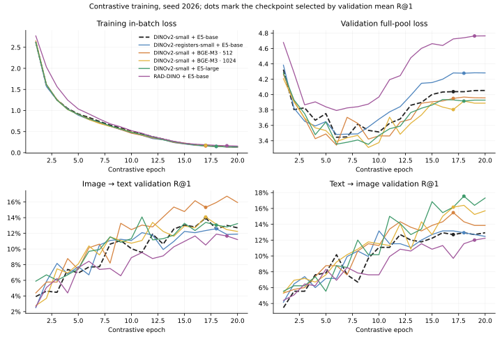
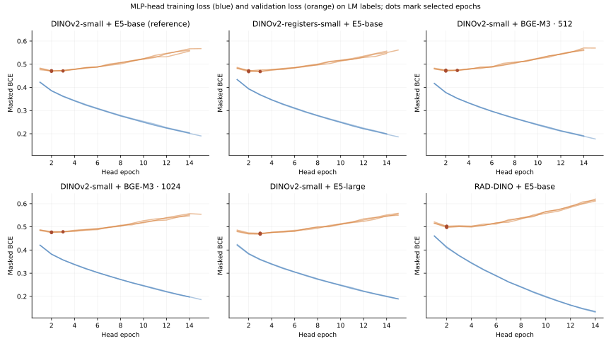
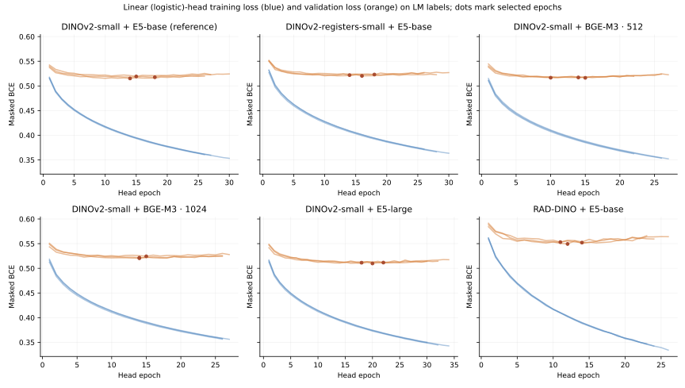

# Next image and text tower pairs: training record and results

Status (2026-09-25): **complete**. Five one-tower swaps against the DINOv2-small + multilingual E5-base reference were trained (contrastive seed 2026) and read out with the 58-case LM-label head protocol from [lm-head-tower-size-58-v1.md](lm-head-tower-size-58-v1.md), using both the MLP head and the linear (logistic) control. DINOv3 is gated and has no local snapshot, so it was not run. The queue and hypotheses are in [next-model-candidates.md](next-model-candidates.md).

## Answer

- **A larger text tower is the only swap with a consistent upside.** DINOv2-small + E5-large has the highest gold MLP AUROC (**0.7815** vs 0.7659), and DINOv2-small + BGE-M3 · 512 has the highest LM-test MLP AUROC (**0.8415** vs 0.8336). Both beat the reference on gold AUROC with both heads, but every one of those paired intervals includes zero.
- **Longer reports did not help.** BGE-M3 at 1,024 tokens is below BGE-M3 at 512 tokens on every AUROC column and took about 5× longer to train because it spilled past the 8 GB GPU.
- **Register tokens did not help.** DINOv2-with-registers is level with or slightly below the reference on every metric.
- **RAD-DINO is worse.** Chest-X-ray pretraining is the only swap whose gold MLP interval excludes zero — in the wrong direction. It was fed 224-pixel ImageNet-normalized input rather than its own 518-pixel preprocessing and is a ViT-B-sized tower, so this is a transfer result for this pipeline, not for RAD-DINO in general.

## Results

Gold AUROCs are macro over 12 labels on all 58 gold studies, which no head training, validation, or epoch selection used. **LM-test AUROC** is masked macro AUROC against `lm_labels_kaggle.csv` verdicts on the 432 non-gold locked-test studies (UNK ignored). Each head is the probability average of seeds 2026–2028. Δ columns are candidate minus reference with a 95% paired study-bootstrap interval (gold: 5,000 resamples; LM-test: 2,000).

| Image tower | Text tower | Gold linear | Gold MLP | Δ gold linear | Δ gold MLP | LM-test linear | LM-test MLP | Δ LM-test MLP |
|---|---|---:|---:|---|---|---:|---:|---|
| DINOv2-small | E5-base (reference) | 0.7336 | 0.7659 | — | — | 0.8140 | 0.8336 | — |
| DINOv2-registers-small | E5-base | 0.7348 | 0.7527 | +0.0012 [-0.0329, +0.0335] | -0.0132 [-0.0410, +0.0134] | 0.8101 | 0.8315 | -0.0021 [-0.0126, +0.0079] |
| DINOv2-small | BGE-M3 · 512 | 0.7573 | 0.7746 | +0.0237 [-0.0059, +0.0574] | +0.0087 [-0.0105, +0.0290] | 0.8252 | 0.8415 | +0.0079 [-0.0002, +0.0155] |
| DINOv2-small | BGE-M3 · 1024 | 0.7498 | 0.7664 | +0.0162 [-0.0097, +0.0436] | +0.0005 [-0.0175, +0.0190] | 0.8145 | 0.8369 | +0.0033 [-0.0038, +0.0106] |
| DINOv2-small | E5-large | 0.7608 | 0.7815 | +0.0272 [-0.0012, +0.0569] | +0.0156 [-0.0043, +0.0357] | 0.8125 | 0.8356 | +0.0020 [-0.0059, +0.0099] |
| RAD-DINO | E5-base | 0.7272 | 0.7246 | -0.0064 [-0.0453, +0.0324] | -0.0414 [-0.0750, -0.0085] | 0.7882 | 0.8027 | -0.0309 [-0.0451, -0.0164] |

LM-test Δ for the linear heads is in [next-model-pairs-v1.json](next-model-pairs-v1.json). The MLP beats the linear control for every tower except RAD-DINO, repeating the earlier four-pair result.

### Contrastive training

Selected epoch follows the frozen rule: validation mean R@1 descending, then validation loss, then earliest epoch. Training loss is in-batch (32 pairs); validation loss is over the full 433-pair pool, so the two are not a matched pair. Time and peak memory come from `run_measured_training.py` telemetry; the reference predates it.

| Image tower | Text tower | Selected epoch | Train loss | Val loss selected / min / final | I→T R@1 | T→I R@1 | Mean R@1 | Hours | Peak GPU alloc |
|---|---|---:|---:|---|---:|---:|---:|---:|---:|
| DINOv2-small | E5-base | 17 | 0.171 | 4.039 / 3.446 / 4.054 | 13.97% | 12.70% | 13.34% | — | — |
| DINOv2-registers-small | E5-base | 18 | 0.147 | 4.279 / 3.481 / 4.282 | 12.59% | 12.93% | 12.76% | 0.7 | 7.6 GB |
| DINOv2-small | BGE-M3 · 512 | 17 | 0.159 | 3.951 / 3.343 / 3.957 | 15.32% | 15.47% | 15.40% | 2.4 | 9.9 GB |
| DINOv2-small | BGE-M3 · 1024 | 17 | 0.176 | 3.806 / 3.313 / 3.889 | 14.09% | 16.17% | 15.13% | 11.8 | 14.8 GB |
| DINOv2-small | E5-large | 18 | 0.149 | 3.916 / 3.353 / 3.929 | 13.05% | 17.55% | 15.30% | 2.2 | 9.8 GB |
| RAD-DINO | E5-base | 19 | 0.165 | 4.763 / 3.794 / 4.764 | 11.66% | 12.01% | 11.84% | 3.7 | 10.2 GB |



All three larger text towers reach lower validation-loss minima (3.31–3.35 vs 3.45) and about 2 points higher mean R@1 than the reference. That retrieval gap is near the ~2.4-point run-to-run spread seen between identical single-seed runs. E5-large's gain is almost entirely text → image. As in every earlier run, validation loss bottoms out mid-training and rises while R@1 keeps improving, so the R@1 rule selects late epochs with above-minimum validation loss. Peak allocations above 8 GB mean the run spilled into WSL shared memory: it completed, but slowly.

### LM-label heads

| Image tower | Text tower | MLP selected epochs | MLP mean val BCE | Linear selected epochs | Linear mean val BCE |
|---|---|---|---:|---|---:|
| DINOv2-small | E5-base | 3, 2, 2 | 0.4708 | 15, 18, 14 | 0.5173 |
| DINOv2-registers-small | E5-base | 3, 2, 2 | 0.4694 | 14, 18, 16 | 0.5218 |
| DINOv2-small | BGE-M3 · 512 | 3, 2, 2 | 0.4726 | 15, 14, 10 | 0.5168 |
| DINOv2-small | BGE-M3 · 1024 | 3, 2, 2 | 0.4771 | 15, 14, 14 | 0.5221 |
| DINOv2-small | E5-large | 3, 3, 3 | 0.4703 | 22, 18, 20 | 0.5110 |
| RAD-DINO | E5-base | 2, 2, 2 | 0.5004 | 14, 12, 11 | 0.5516 |





The MLP heads again select epoch 2–3 and overfit afterwards; the linear heads select later and rebound less. RAD-DINO's features give the highest LM-label validation BCE for both heads, consistent with its lower AUROCs.

### Gold AUROC by label (MLP)

| Label | DINOv2-small + E5-base | DINOv2-registers-small + E5-base | DINOv2-small + BGE-M3 · 512 | DINOv2-small + BGE-M3 · 1024 | DINOv2-small + E5-large | RAD-DINO + E5-base |
|---|---:|---:|---:|---:|---:|---:|
| ACL | 0.6973 | 0.6630 | 0.6777 | 0.6789 | 0.7439 | **0.7733** |
| Baker's | 0.8388 | 0.7935 | **0.8714** | 0.8188 | 0.8370 | 0.6576 |
| Contusion | 0.7773 | 0.7247 | **0.8111** | 0.7922 | 0.7922 | 0.6356 |
| Effusion | **0.9081** | 0.8969 | 0.8932 | 0.8770 | 0.9068 | 0.9043 |
| Fracture | 0.6597 | 0.6097 | **0.6625** | 0.6556 | 0.6569 | 0.5972 |
| Lateral Meniscus | **0.7130** | 0.7093 | 0.6609 | 0.6870 | 0.6845 | 0.7019 |
| Lateral OA | 0.7060 | **0.7795** | 0.7640 | 0.7021 | 0.7350 | 0.7195 |
| MCL | 0.6122 | 0.6372 | 0.6327 | 0.6667 | **0.7234** | 0.6327 |
| Medial Meniscus | 0.7608 | 0.7380 | 0.7344 | 0.7608 | 0.7584 | **0.7728** |
| Medial OA | 0.9349 | 0.9504 | 0.9488 | **0.9612** | 0.9457 | 0.8279 |
| PF OA | 0.7825 | 0.7632 | **0.8172** | 0.7915 | 0.7876 | 0.8018 |
| Synovitis | 0.8005 | 0.7670 | **0.8220** | 0.8053 | 0.8065 | 0.6703 |

## Training settings

Every trained arm shares the reference settings except the swapped tower (and, for 1,024, the context cap). Run configs were diffed against the reference: the only other differences are options added since it was trained, all at inactive defaults (DeCLIP off, temperature not frozen, inverse-temperature cap 100, never reached).

| Pair / status | MRI Input Dimensions | Image Models | Text Models | Image Unfrozen Layers | Text Unfrozen Layers | Medical Report Languages | Batch Size | Supervise method for similarity matrix | Learning Rate | LoRA Rank | LoRA Alpha | LoRA Dropout | Projection Layer LR | Weight Decay | Warmup | Projection Layer | Local AUC (58 gold labels) | ItoT_Recall@1 | TtoI_Recall@1 |
| --- | --- | --- | --- | --- | --- | --- | ---: | --- | ---: | ---: | ---: | ---: | ---: | ---: | --- | --- | ---: | ---: | ---: |
| Reference · complete | 2.5D: 3 planes × 3 slices, 224² | DINOv2-small | multilingual E5-base | LoRA last 6 | LoRA last 6 | Original, full report; 512 tokens | 32 | CLIP identity | 1e-4 image / text | 64 | 128 | 0 | 1e-3 | 0.02 | 10% linear, then cosine | 256d | 0.7659 | 13.97% | 12.70% |
| DINOv2-registers-small + E5-base · complete | 2.5D: 3 planes × 3 slices, 224² | DINOv2-registers-small | multilingual E5-base | LoRA last 6 | LoRA last 6 | Original, full report; 512 tokens | 32 | CLIP identity | 1e-4 image / text | 64 | 128 | 0 | 1e-3 | 0.02 | 10% linear, then cosine | 256d | 0.7527 | 12.59% | 12.93% |
| DINOv2-small + BGE-M3 · 512 · complete | 2.5D: 3 planes × 3 slices, 224² | DINOv2-small | BGE-M3 | LoRA last 6 | LoRA last 6 | Original, full report; 512 tokens | 32 | CLIP identity | 1e-4 image / text | 64 | 128 | 0 | 1e-3 | 0.02 | 10% linear, then cosine | 256d | 0.7746 | 15.32% | 15.47% |
| DINOv2-small + BGE-M3 · 1024 · complete | 2.5D: 3 planes × 3 slices, 224² | DINOv2-small | BGE-M3 | LoRA last 6 | LoRA last 6 | Original, full report; 1024 tokens | 32 | CLIP identity | 1e-4 image / text | 64 | 128 | 0 | 1e-3 | 0.02 | 10% linear, then cosine | 256d | 0.7664 | 14.09% | 16.17% |
| DINOv2-small + E5-large · complete | 2.5D: 3 planes × 3 slices, 224² | DINOv2-small | multilingual E5-large | LoRA last 6 | LoRA last 6 | Original, full report; 512 tokens | 32 | CLIP identity | 1e-4 image / text | 64 | 128 | 0 | 1e-3 | 0.02 | 10% linear, then cosine | 256d | 0.7815 | 13.05% | 17.55% |
| RAD-DINO + E5-base · complete | 2.5D: 3 planes × 3 slices, 224² | RAD-DINO | multilingual E5-base | LoRA last 6 | LoRA last 6 | Original, full report; 512 tokens | 32 | CLIP identity | 1e-4 image / text | 64 | 128 | 0 | 1e-3 | 0.02 | 10% linear, then cosine | 256d | 0.7246 | 11.66% | 12.01% |
| DINOv3-small + E5-base · gated, not run | 2.5D: 3 planes × 3 slices, 224² planned | DINOv3 ViT-S/16 | multilingual E5-base | LoRA last 6 planned | LoRA last 6 planned | Original, full report; 512 tokens planned | 32 planned | CLIP identity planned | 1e-4 planned | 64 planned | 128 planned | 0 planned | 1e-3 planned | 0.02 planned | 10% linear, then cosine planned | 256d planned | — | — | — |

Local AUC is the 3-seed LM-MLP head on the 58 gold studies. BGE-M3 uses mean pooling without E5's `query: ` prefix. The register model excludes its four register tokens from patch pooling in training and in exported features. RAD-DINO kept the reference 224-pixel input for a one-tower comparison.

## Limits

- **One contrastive seed per tower.** Identical single-seed runs have differed by ~0.024 mean R@1, and the paired intervals above condition on the fitted towers and heads, so they do not capture tower-training variation. Repeating E5-large and BGE-M3-512 with more seeds is the direct test of the text-tower result.
- **The 58 gold labels are not a clean test.** They have been examined repeatedly across the project, including the two formerly reserved test cases. Treat gold differences as exploratory.
- **LM-test AUROC scores against pseudo-labels** from the same LM that supervised the heads; it is like-for-like across these arms but is not a gold measure.
- The contrastive validation selection was not finalized with `finalize_contrastive_matrix`; no immutable `validation-selection.json` exists for this matrix yet.

## Reproduction

```bash
# contrastive arms, one at a time (each under run_measured_training.py for time/memory telemetry)
.venv-cuda/bin/python scripts/training/run_contrastive_matrix.py --matrix configs/contrastive/next-model-pairs-v1.json --dry-run
# LM heads (linear + MLP, 3 seeds) and LM-test score, per arm
.venv-cuda/bin/python scripts/training/train_lm_head.py --config configs/kaggle/lm-mlp-next-pairs-58-<arm>.json \
  --features checkpoints/kaggle/lm-mlp-next-pairs-58-<arm>-features.npz \
  --output checkpoints/kaggle/lm-mlp-next-pairs-58-<arm> --device cuda
# this page, its JSON and figures
.venv/bin/python scripts/digests/build_next_model_pairs_digest.py
```

Run artifacts are under `checkpoints/contrastive/next-model-pairs-v1/` and `checkpoints/kaggle/lm-mlp-next-pairs-58-*/`. The encoder page of the digest site plots the same contrastive curves after `scripts/digests/build_digest_site.py export`.
