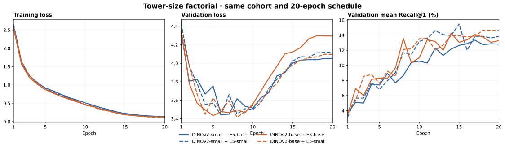

# Image and text tower size comparison

## Question

Does moving from the selected DINOv2-small + multilingual-e5-base pair to closer-sized towers improve gold-label readout? Does the larger text tower specifically cause overfitting when paired with the smaller image tower?

The completed two-tower swap cannot isolate either tower. This note was created to record that result and the two missing single-tower arms before either new run began.

The original contrastive and gold-only probe results below use 56 gold cases. A later LM-supervised-head follow-up uses all 58 and is recorded at the end of this page; its AUROC is a separate evaluation protocol.

## Frozen comparison

| Image tower | Text tower | Role | State |
| --- | --- | --- | --- |
| DINOv2-small | multilingual-e5-base | Selected reference | Complete |
| DINOv2-base | multilingual-e5-small | Two-tower swap | Complete |
| DINOv2-small | multilingual-e5-small | Text-only swap | Complete |
| DINOv2-base | multilingual-e5-base | Image-only swap | Complete |

Every arm uses the same gold-excluded cohort (3,478 training and 433 validation image–report pairs), report view, preprocessing, E5 mean pooling and `query: ` prefix, 512-token limit, seed 2026, 20 epochs, batch size 32, six LoRA blocks in each tower, rank 64, alpha 128, learning rates, and validation Recall@1 checkpoint rule. The two new arms use the pinned model revisions already used by the completed arms. The primary downstream readout is the existing 56-study, 12-label, eight-fold out-of-fold logistic probe using uniform mean CLS+patch image features. The two locked gold test studies remain unused. Each arm also reports loss curves, retrieval recall, and the learned plane-attention and projection readouts as secondary checks.

The single-tower contrasts are: text-only swap versus the selected reference; image-only swap versus the selected reference. The 2×2 grid also allows the interaction to be examined, but one seed and 56 repeatedly examined gold studies limit causal and statistical generality. Backbone width changes the image feature dimension (768 versus 1,536), so the fixed logistic probe is a matched protocol, not an equal-dimensional classifier.

Pinned backbone parameter counts are approximately 22.1M (DINOv2-small), 86.6M (DINOv2-base), 117.7M (E5-small), and 278.0M (E5-base), excluding projection heads and LoRA adapters. The text-to-image count ratios are about 12.6:1 (small/base), 5.3:1 (small/small), 3.2:1 (base/base), and 1.36:1 (base/small). “Matched” here means closer in backbone parameter count, not equal capacity or architecture. Changing backbone width also changes the number of trainable LoRA and projection parameters under the same rank and projection settings; the experiment compares these concrete model choices, not parameter count in isolation.

## Recorded result before the new runs

The completed DINOv2-base + E5-small run finished all 20 epochs and selected epoch 18. Validation mean Recall@1 rose from **13.34%** for the reference (epoch 17) to **14.67%**. On the same 56 gold studies, macro AUROC fell from **0.75936** to **0.69687**: difference **−0.06249**, paired 95% study-bootstrap interval **[−0.10563, −0.01909]**. The reference's validation loss bottomed at 3.4458 in epoch 6 and finished at 4.0539; the two-tower swap bottomed at 3.4157 in epoch 8 and finished at 4.0974. Both training losses fell to roughly 0.1. Closer parameter counts did not improve the gold readout in this two-tower comparison, while retrieval improved. That result alone does not identify which tower caused the change or prove text-specific overfitting.

Sources: [HTML digest](size-matched-holdout-v1.html), [numeric comparison](size-matched-holdout-v1.json), [training matrix](../configs/contrastive/size-matched-holdout-v1.json), and [gold probe](size-matched-holdout-probe.json).

## Four-arm result

Both new runs completed all 20 epochs at the frozen batch size of 32, without activation checkpointing or another memory accommodation. The listed checkpoint in each arm was selected by validation mean bidirectional Recall@1, before the gold-label probe. Gold AUROC and AUPRC use the same 56 excluded studies, 12 labels, eight folds, and uniform mean CLS+patch image features in every arm. Recall is measured on the separate 433-pair contrastive validation split.

| Image / text | Text:image backbone size | Selected epoch | Validation mean R@1 | Validation loss minimum → final | Gold macro AUROC | Gold macro AUPRC |
| --- | ---: | ---: | ---: | ---: | ---: | ---: |
| **DINOv2-small / E5-base (reference)** | 12.6:1 | 17 | 13.34% | 3.446 (epoch 6) → 4.054 | **0.7594** | **0.6342** |
| DINOv2-small / E5-small (text only) | 5.3:1 | 15 | **15.47%** | 3.441 (epoch 6) → 4.119 | 0.7382 | 0.5928 |
| DINOv2-base / E5-base (image only) | 3.2:1 | 14 | 14.26% | 3.434 (epoch 5) → 4.295 | 0.6999 | 0.5697 |
| DINOv2-base / E5-small (both towers) | 1.36:1 | 18 | 14.67% | 3.416 (epoch 8) → 4.097 | 0.6969 | 0.5708 |

Each arm's training loss continued to fall (final range 0.119–0.135), while validation loss reached its minimum in epochs 5–8 and ended higher. That is evidence of overfitting to the contrastive training pairs across **all** four combinations. The image-only arm had the largest loss rebound, 3.434 → 4.295. Retrieval recall could still rise after validation loss began increasing, so the two metrics describe different behavior.

## Paired gold-label contrasts

Positive differences favor the model named first. Intervals are 95% paired study-bootstrap intervals from 5,000 resamples of the fixed out-of-fold predictions. They are descriptive for these studies; they do not account for repeated model exploration or unknown patient overlap.

| Comparison | Macro AUROC difference | Paired 95% interval |
| --- | ---: | ---: |
| E5-small minus E5-base, DINOv2-small fixed | −0.0212 | [−0.0480, +0.0073] |
| DINOv2-base minus DINOv2-small, E5-base fixed | **−0.0595** | **[−0.1017, −0.0167]** |
| E5-small minus E5-base, DINOv2-base fixed | −0.0030 | [−0.0283, +0.0228] |
| DINOv2-base minus DINOv2-small, E5-small fixed | −0.0413 | [−0.0869, +0.0033] |
| Both-tower swap minus reference | −0.0625 | [−0.1056, −0.0191] |

The text-size effect differs by +0.0182 AUROC between the two image backbones (95% interval [−0.0207, +0.0548]); the interval spans zero. This grid does not establish a reliable image-by-text size interaction.

The secondary readouts give the same broad ranking. Macro AUROC from learned plane attention / the 256-dimensional contrastive projection is 0.7510 / 0.7062 for the reference, 0.7370 / 0.7017 for text only, 0.7057 / 0.6936 for image only, and 0.7019 / 0.6975 for both towers. These were checked after the uniform-mean primary readout and did not select checkpoints or alter the primary conclusion.

Per-label AUROC from the primary uniform-mean probe is shown below. Individual labels have substantially more uncertainty than the macro average, especially MCL with eight positives.

| Gold label | Small / base | Small / small | Base / base | Base / small |
| --- | ---: | ---: | ---: | ---: |
| ACL | 0.740 | 0.718 | 0.694 | 0.630 |
| MCL | 0.701 | 0.734 | 0.417 | 0.453 |
| Medial Meniscus | 0.737 | 0.641 | 0.694 | 0.715 |
| Lateral Meniscus | 0.686 | 0.671 | 0.674 | 0.647 |
| Medial OA | 0.942 | 0.973 | 0.925 | 0.867 |
| Lateral OA | 0.828 | 0.731 | 0.778 | 0.828 |
| PF OA | 0.664 | 0.646 | 0.553 | 0.588 |
| Effusion | 0.905 | 0.892 | 0.856 | 0.830 |
| Synovitis | 0.595 | 0.588 | 0.631 | 0.638 |
| Baker's | 0.771 | 0.773 | 0.784 | 0.799 |
| Contusion | 0.872 | 0.825 | 0.752 | 0.805 |
| Fracture | 0.671 | 0.665 | 0.641 | 0.561 |

## Answers

**Is matching tower parameter counts necessary here? No.** The most size-imbalanced pair, DINOv2-small + E5-base (12.6:1 text:image backbone parameters), has the highest observed gold macro AUROC, 0.7594. Making both towers closer in size improved validation retrieval from 13.34% to 14.67% mean R@1 but lowered gold AUROC to 0.6969. Changing only the image tower accounts for most of that gold drop (−0.0595), while shrinking only the text tower gives a smaller, uncertain difference (−0.0212). The text-only small/small pair achieved the best retrieval, 15.47%, so the preferred model depends on whether retrieval or pathology-label readout is the objective. Under the stated gold-label objective, keep the selected small-image/base-text pair.

**Is the larger text tower overfitting the smaller image tower? The data do not support that specific claim.** With DINOv2-small fixed, E5-base has higher observed gold AUROC than E5-small (0.7594 versus 0.7382), although the paired interval for the difference includes zero. Its validation-loss rebound is slightly smaller (3.446 → 4.054 versus 3.441 → 4.119). All four pairs show train–validation divergence, but the larger text tower does not uniquely worsen it when the image tower is small. The largest rebound occurs with DINOv2-base + E5-base. The joint loss curves cannot assign an overfitting mechanism to one tower, and the single seed plus 56 repeatedly examined gold studies limit stronger claims.

## Reproduction and limits

[Training matrix](../configs/contrastive/tower-size-factorial-v1.json), [text-only probe protocol](../configs/downstream/gold-probe-tower-size-text-small-v1.json), [image-only probe protocol](../configs/downstream/gold-probe-tower-size-image-base-v1.json), [machine-readable four-arm result](tower-size-factorial-v1.json), [text-only full probe](tower-size-text-small-probe.json), and [image-only full probe](tower-size-image-base-probe.json) preserve the settings and per-label scores. The [HTML digest](tower-size-factorial-v1.html) presents this record as a page.

The probe uses just 56 gold studies, with only eight MCL positives. The study bootstrap does not resolve patient identity, repeated gold-set examination, seed sensitivity, or architecture and pretraining differences between the four pinned backbones. DINOv2-small and DINOv2-base also yield different feature widths (768 versus 1,536), even with the same logistic probe protocol. The two gold test studies were never used for training, checkpoint selection, or this original 56-case analysis. They were subsequently scored in the 58-case LM-head follow-up below. No new independent patient test was run.

## Follow-up: LM-supervised heads on all 58 gold cases

Each of these four frozen, gold-holdout image encoders was reused to train the same three-seed, 12-label MLP head on `data/lm_label/lm_labels_kaggle.csv`. All 58 gold studies were excluded from head training and validation; 3,438 LM-labeled studies trained the heads and 426 selected their epochs. The two former gold test cases were included in scoring, so they are no longer an untouched future test. This is a different supervised readout from the 56-case gold-only logistic probe above, and the two AUROC columns should not be compared as a paired change.

| Image / text | 58-case LM-head macro AUROC | Selected LM-head epochs |
| --- | ---: | --- |
| **DINOv2-small / E5-base** | **0.7659** | 3, 2, 2 |
| DINOv2-small / E5-small | 0.7541 | 2, 2, 2 |
| DINOv2-base / E5-base | 0.7504 | 2, 2, 2 |
| DINOv2-base / E5-small | 0.7605 | 1, 2, 2 |

The size-mismatched pairs have the higher point estimate within each image size. E5-base minus E5-small with DINOv2-small fixed is **+0.0119** macro AUROC, paired 95% interval **[−0.0079, +0.0324]**. All four one-tower paired intervals include zero. The follow-up therefore does not establish a reliable population advantage for either tower size, but it provides no evidence that E5-base uniquely overfits DINOv2-small or that tower sizes must match. The LM heads themselves show rising validation loss after their early selected epochs.

The matched LM-supervised **linear controls** scored 0.7336, 0.7312, 0.7330, and 0.7362 respectively in the table order above. Their late validation-loss rise was much smaller than the MLPs', but their selected gold AUROC was lower in every pairing. The [full follow-up](lm-head-tower-size-58-v1.md#linear-control-less-late-overfitting-lower-gold-auroc) includes the per-arm MLP-minus-linear intervals and both sets of loss curves.

See the [58-case Markdown report](lm-head-tower-size-58-v1.md), [HTML digest with head-loss curves](lm-head-tower-size-58-v1.html), and [machine-readable paired comparisons](lm-head-tower-size-58-v1.json).
